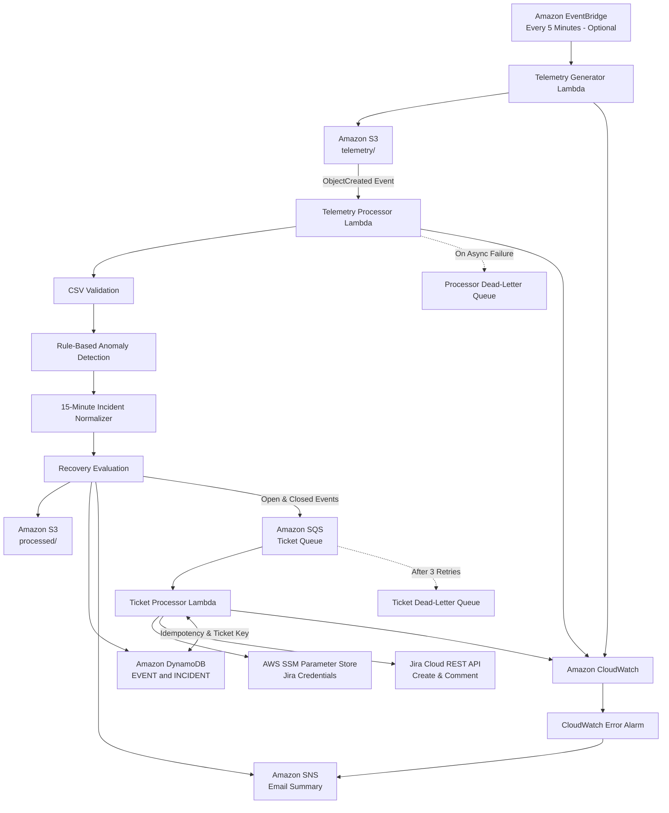
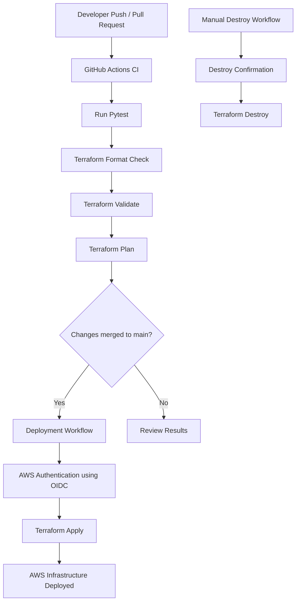

# Solar Asset Monitoring & Incident Automation Platform

An end-to-end, serverless AWS platform that automates solar inverter telemetry generation, ingestion, anomaly detection, incident correlation, recovery tracking, notifications, and Jira maintenance ticket integration.

**Repository:** [github.com/rushikeshgokhe/solar-asset-monitoring](https://github.com/rushikeshgokhe/solar-asset-monitoring)


---

## 1. Project Overview

Solar power plants contain multiple sites, inverters, and monitoring devices that continuously generate operational telemetry. Monitoring these devices manually can make it difficult to identify equipment faults, investigate recurring problems, track incidents, and coordinate maintenance activities.

This project demonstrates an automated monitoring and incident management workflow using Python and AWS serverless services.

The platform generates simulated telemetry for multiple solar sites, uploads it to Amazon S3, processes the incoming data through AWS Lambda, detects operational anomalies using predefined rules, and groups recurring faults into meaningful incident episodes.

It also maintains incident state in Amazon DynamoDB, evaluates recovery conditions, sends notification summaries through Amazon SNS, and places actionable incidents into Amazon SQS for asynchronous Jira ticket integration.

The infrastructure is provisioned using Terraform, while GitHub Actions automates testing, infrastructure validation, deployment, and controlled teardown.

### Key objectives

- Automate solar telemetry generation and ingestion.
- Detect operational anomalies from inverter readings.
- Reduce duplicate alerts through incident correlation.
- Maintain incident history and lifecycle state.
- Identify when an inverter has recovered.
- Integrate maintenance ticket processing with Jira.
- Build a reliable, event-driven AWS architecture.
- Automate infrastructure provisioning through Terraform.
- Implement CI/CD using GitHub Actions and AWS OIDC.
- Keep cloud resources controlled through an explicit teardown workflow.

---

## 2. Architecture

The platform follows an event-driven, serverless architecture.



### Architecture workflow

1. Amazon EventBridge triggers the telemetry generator every five minutes.
2. The generator creates a timestamped CSV batch containing simulated inverter readings.
3. The CSV file is uploaded to the `telemetry/` prefix of an Amazon S3 bucket.
4. An S3 ObjectCreated event invokes the telemetry processor Lambda.
5. The processor validates the incoming records and applies anomaly detection rules.
6. The incident normalizer groups recurring faults within a 15-minute correlation window.
7. The recovery engine evaluates healthy telemetry and updates incident status.
8. Processed incident reports are stored in the S3 `processed/` prefix.
9. Event and incident records are maintained in DynamoDB.
10. Amazon SNS sends an email summary.
11. Actionable incident messages are placed in an SQS ticket queue.
12. The ticket processor retrieves Jira credentials from SSM Parameter Store and integrates with Jira Cloud.
13. CloudWatch collects execution logs and monitors Lambda errors.

---

## 3. Technology Stack

| Category | Technologies |
|---|---|
| Programming language | Python |
| Cloud platform | Amazon Web Services |
| Object storage | Amazon S3 |
| Serverless compute | AWS Lambda |
| Scheduling | Amazon EventBridge |
| Database | Amazon DynamoDB |
| Messaging | Amazon SQS |
| Notifications | Amazon SNS |
| Monitoring | Amazon CloudWatch |
| Secrets management | AWS Systems Manager Parameter Store |
| External integration | Jira Cloud REST API |
| Infrastructure as Code | Terraform |
| CI/CD | GitHub Actions |
| Authentication | GitHub Actions OIDC |
| Testing | Pytest |
| Data format | CSV |
| Version control | Git and GitHub |

---

## 4. System Components

### 4.1 Automated Telemetry Generator

**AWS services:** Amazon EventBridge, AWS Lambda, Amazon S3

The telemetry generator removes the need to depend on a continuously running local data-generation server.

An EventBridge scheduled rule triggers the generator Lambda every five minutes.

The generator creates realistic timestamped CSV batches for:

- 4 solar sites
- 12 inverters
- Multiple operational readings
- Normal and simulated fault conditions

The generated readings include:

- Timestamp
- Site ID
- Inverter ID
- AC power
- DC voltage
- Inverter temperature
- Global horizontal irradiance (GHI)
- Interval energy

The generated CSV batches are uploaded to the S3 `telemetry/` prefix.

### 4.2 Data Validation

**Component:** `src/processor/rules.py`

Before anomaly detection, the processor validates incoming CSV records.

The validation process checks the required columns:

- `timestamp`
- `site_id`
- `inverter_id`
- `ac_power_kw`
- `dc_voltage_v`
- `inverter_temp_c`
- `ghi_w_m2`
- `energy_kwh_interval`

Malformed records are skipped safely, and the processor tracks the number of skipped rows.

### 4.3 Rule-Based Anomaly Detection

The platform uses predefined operational rules to identify potential inverter faults.

It does not use machine learning or AI for anomaly detection.

| Anomaly | Severity | Detection condition |
|---|---|---|
| ZERO_POWER | HIGH | Irradiance ≥ 200 W/m² and AC power ≤ 1 kW |
| HIGH_TEMPERATURE | HIGH | Inverter temperature ≥ 80°C |
| MISSING_TELEMETRY | MEDIUM | Reading gap greater than 5 minutes for the same site and inverter |

These rules demonstrate how operational telemetry can be converted into actionable monitoring events.

### 4.4 Incident Correlation and Normalization

**Component:** `src/processor/normalizer.py`

A single equipment fault can generate repeated anomaly detections across multiple telemetry batches.

Creating a separate incident for every repeated detection would increase alert volume and create unnecessary maintenance work.

To address this, the platform implements a 15-minute sliding correlation window.

Recurring faults with the same:

- Site ID
- Inverter ID
- Incident type

are grouped into one incident episode when they occur within the correlation window.

The normalizer:

- Preserves the original `first_detected` timestamp.
- Updates `last_detected`.
- Increments `occurrence_count`.
- Protects timestamps from moving backwards when events arrive out of order.
- Maintains incident state across telemetry batches.

The incident lifecycle is:

```text
NEW → OPEN → RESOLVED
```

A new episode can be created when the same fault occurs outside the correlation window or after an earlier episode has been resolved.

### 4.5 DynamoDB Incident Repository

**Component:** `src/processor/incident_repository.py`

Amazon DynamoDB stores event and incident information in a single-table design.

Two item types are maintained.

**EVENT items**

Used to track individual anomaly events and prevent duplicate processing.

| Attribute | Description |
|---|---|
| `pk` | Site and inverter identifier |
| `sk` | Event type and event timestamp |
| Event attributes | Information about the detected event |

Example key structure:

```text
pk = SITE-101#INV-01
sk = EVENT#ZERO_POWER#2026-11-21T10:00:00Z
```

**INCIDENT items**

Used to maintain consolidated incident episodes.

| Attribute | Description |
|---|---|
| `pk` | Site and inverter identifier |
| `sk` | Incident type and episode start |
| `occurrence_count` | Number of correlated detections |
| `ticket_created` | Jira ticket creation tracking |
| Incident state | NEW, OPEN, or RESOLVED |

Example key structure:

```text
pk = SITE-101#INV-01
sk = INCIDENT#ZERO_POWER#2026-11-21T10:00:00Z
```

### 4.6 Idempotency and Duplicate Protection

Amazon S3 event notifications provide at-least-once delivery behavior. Therefore, the same object event may be delivered more than once.

The project implements duplicate protection using DynamoDB transactional writes.

The repository uses `TransactWriteItems` with a conditional expression:

```python
ConditionExpression="attribute_not_exists(pk)"
```

This prevents the same event from being stored repeatedly.

Duplicate processing does not inflate the incident occurrence count or generate duplicate ticket-queue messages.

### 4.7 Automatic Recovery Detection

**Component:** `src/processor/recovery.py`

Detecting a fault is only one part of equipment monitoring. The system also needs to determine when the equipment returns to healthy operation.

The recovery engine evaluates healthy readings for the matching inverter across telemetry batches.

When the recovery criteria are satisfied, an open incident is transitioned to:

```text
RESOLVED
```

If the same fault occurs again later, the system can create a new incident episode instead of incorrectly reusing the resolved one.

### 4.8 Asynchronous Jira Ticket Integration

**Component:** `src/ticket_processor/handler.py`

The platform separates incident processing from external maintenance ticket creation.

When a new actionable incident is identified, the processor places a message into:

```text
solar-monitoring-tickets
```

A separate ticket processor Lambda consumes messages from this SQS queue.

This design prevents external Jira API latency and temporary failures from directly blocking telemetry processing.

The ticket processor:

1. Reads the incident message from SQS.
2. Checks DynamoDB to determine whether a ticket has already been created.
3. Retrieves Jira credentials from AWS Systems Manager Parameter Store.
4. Calls the Jira Cloud REST API.
5. Creates the maintenance issue.
6. Updates the DynamoDB incident record with `ticket_created = true`.

Jira credentials are stored as encrypted `SecureString` parameters rather than hardcoded in the application.

The implementation also uses conditional DynamoDB updates to protect ticket creation against message retries.

### 4.9 Notifications with Amazon SNS

Amazon SNS provides email notifications containing processing summaries and detected incident information.

The processor publishes a human-readable summary after processing the telemetry batch.

CloudWatch error alarms are also connected to SNS for operational notifications.

### 4.10 Resilience with Amazon SQS Dead-Letter Queues

The architecture uses separate queues for normal ticket processing and failed-message handling.

| Queue | Purpose |
|---|---|
| `solar-monitoring-tickets` | Normal maintenance ticket messages |
| `solar-monitoring-dlq` | Failed telemetry processor invocations |
| `solar-monitoring-ticket-dlq` | Failed ticket processor messages |

The processor failure queue is configured with two retries.

The ticket queue uses `maxReceiveCount = 3` before a message is moved to its dead-letter queue.

This helps isolate failures and supports later investigation.

---

## 5. AWS Infrastructure

The infrastructure is provisioned using Terraform.

**AWS Region:** `ap-south-1` (Mumbai)

The application stack defines 24 AWS resources when deployed.

The architecture includes:

- S3 bucket and event notification configuration
- Three Lambda functions
- EventBridge scheduling
- DynamoDB incident table
- SNS notification topic
- SQS ticket queue
- Separate dead-letter queues
- Lambda event source mapping
- CloudWatch log groups
- CloudWatch error alarm
- IAM roles and policies
- Required permissions and integrations

The three Lambda functions are:

| Lambda function | Responsibility |
|---|---|
| `solar-monitoring-generator` | Generates and uploads telemetry |
| `solar-monitoring-processor` | Validates data, detects anomalies, manages incidents |
| `solar-monitoring-ticket-processor` | Processes SQS messages and integrates with Jira |

CloudWatch log groups are configured with a seven-day retention period.

Separate least-privilege IAM roles are used for the generator, processor, and ticket processor.

S3 input and output prefixes are isolated to prevent processed files from recursively triggering the input processor.

---

## 6. Terraform and Infrastructure Management

The project uses Terraform to define and manage AWS infrastructure.

The infrastructure is divided into two parts.

### Bootstrap stack

The bootstrap stack provisions the resources required for Terraform remote state and GitHub Actions authentication.

It includes:

- Remote Terraform state S3 bucket: `solar-tfstate-epcrkb`
- Native Terraform state lockfile support using `use_lockfile = true`
- GitHub Actions OIDC identity provider
- IAM role for GitHub Actions

The GitHub Actions trust policy is restricted to the project repository.

### Application stack

The application stack provisions the AWS resources required to run the monitoring platform.

The Terraform configuration is organized across files including:

```text
bootstrap/main.tf
terraform/main.tf
terraform/reliability.tf
terraform/automation.tf
```

The application stack is designed to be deployed and destroyed through controlled workflows.

**Important:** Destroying the application stack does not automatically mean the separate bootstrap resources, including the Terraform state bucket and OIDC resources, have also been deleted.

---

## 7. CI/CD with GitHub Actions

The project uses GitHub Actions to automate testing, infrastructure validation, and deployment.

Three workflows are configured under:

```text
.github/workflows/
```

### CI workflow — `ci.yml`

Runs on pull requests.

The workflow performs:

- Python automated tests using Pytest.
- Terraform formatting checks.
- Terraform configuration validation.
- Terraform plan.

### Deployment workflow — `deploy.yml`

Runs on merges to the `main` branch.

It:

1. Runs the automated test suite.
2. Authenticates to AWS through GitHub Actions OIDC.
3. Executes Terraform deployment.

Static AWS access keys are not stored in GitHub for this authentication workflow.

### Destroy workflow — `destroy.yml`

Provides a manually gated infrastructure teardown process.

The workflow requires a destroy confirmation input before proceeding.

This helps prevent accidental infrastructure deletion.

### CI/CD workflow diagram



---

## 8. Project Structure

The following are the principal paths documented for the project:

```text
solar-asset-monitoring/
│
├── .github/
│   └── workflows/
│       ├── ci.yml
│       ├── deploy.yml
│       └── destroy.yml
│
├── bootstrap/
│   └── main.tf
│
├── terraform/
│   ├── main.tf
│   ├── reliability.tf
│   └── automation.tf
│
├── src/
│   ├── generator/
│   │   └── handler.py
│   │
│   ├── processor/
│   │   ├── rules.py
│   │   ├── normalizer.py
│   │   ├── incident_repository.py
│   │   └── recovery.py
│   │
│   └── ticket_processor/
│       └── handler.py
│
├── reports/
│   └── screenshots/
│
├── tests/
│
├── README.md
└── requirements.txt
```

This is a high-level view of the principal components. Refer to the repository for the complete current file structure.

---

## 9. Sample Anomaly Detection Results

The project includes a historical sample telemetry dataset containing 3,452 readings.

The documented verification run reported:

| Metric | Result |
|---|---:|
| Telemetry rows processed | 3,452 |
| Skipped rows | 0 |
| ZERO_POWER detections | 12 |
| HIGH_TEMPERATURE detections | 12 |
| MISSING_TELEMETRY detections | 1 |
| Total raw anomaly detections | 25 |

These detections represent three consolidated incident groups in the sample scenario:

| Site | Inverter | Incident type | Occurrences | Severity |
|---|---|---|---:|---|
| SITE-104 | INV-03 | ZERO_POWER | 12 | HIGH |
| SITE-102 | INV-02 | HIGH_TEMPERATURE | 12 | HIGH |
| SITE-103 | INV-01 | MISSING_TELEMETRY | 1 | MEDIUM |

The resulting incident register is exported to the S3 `processed/` prefix in CSV format.

The CSV output can be used for further analysis and Power BI reporting.

---

## 10. Reliability and Engineering Considerations

The platform demonstrates several important cloud engineering practices.

### Event-driven processing

S3 ObjectCreated notifications trigger telemetry processing without requiring a continuously running server.

### Idempotent processing

DynamoDB conditional and transactional writes protect against duplicate event processing.

### Incident correlation

A 15-minute window consolidates repeated detections into meaningful incident episodes.

### Out-of-order event handling

The normalizer protects incident timestamps from moving backwards when events arrive out of order.

### Independent ticket processing

SQS decouples maintenance ticket creation from the telemetry processing workflow.

### Retry and failure handling

Separate dead-letter queues capture failed processor and ticket messages.

### Least-privilege IAM

Separate execution roles are used for the three Lambda functions.

### Secure credential management

Jira credentials are stored in SSM Parameter Store as encrypted SecureString parameters.

### Monitoring and observability

CloudWatch logs and error alarms provide visibility into system execution and failures.

---

## 11. Automated Testing

The project uses Pytest to test the Python processing and incident-management logic.

The latest engineering verification notes report:

**61 automated unit and integration tests passing.**

The test coverage includes the main application behaviors:

- Telemetry validation
- Anomaly detection rules
- Incident normalization
- Cross-batch correlation
- Duplicate event protection
- Incident repository behavior
- Recovery detection
- Incident lifecycle management
- Ticket processing logic

The CI workflow also performs Terraform formatting, validation, and planning checks.

Run the tests locally from the project root:

```powershell
python -m pytest -q
```

For detailed test output:

```powershell
python -m pytest -v
```

---

## 12. Deployment Overview

The project is designed to use Terraform for AWS infrastructure provisioning.

Before deployment, the required AWS account, Terraform backend, GitHub OIDC configuration, repository secrets or variables, and Jira integration settings must be configured.

### General deployment sequence

1. Configure the AWS account and required permissions.
2. Provision the Terraform bootstrap infrastructure.
3. Configure GitHub Actions OIDC authentication.
4. Configure the required Terraform variables.
5. Configure Jira credentials in SSM Parameter Store.
6. Run the CI workflow.
7. Deploy the application stack using the deployment workflow.
8. Verify the Lambda functions, S3 events, DynamoDB table, queues, SNS topic, and CloudWatch resources.
9. Verify telemetry processing and incident creation.
10. Verify Jira integration using an actionable incident.

The exact Terraform variable values and environment-specific settings should be taken from the current Terraform configuration and repository setup instructions. Do not commit credentials, tokens, or Terraform secret variable files.

---

## 13. Verification and Testing Evidence

The engineering handover documents an end-to-end verification run in AWS region `ap-south-1`.

The reported verification results include:

| Verification | Reported result |
|---|---|
| Pytest suite | 61 tests passed |
| Terraform CI checks | Passed |
| Lambda deployment | Three functions active during verification |
| Historical telemetry processing | 3,452 rows processed |
| Raw anomaly detections | 25 |
| Skipped rows | 0 |
| Incident correlation | Verified |
| New episode after 92 minutes | Verified |
| Recovery transition | Verified |
| S3 replay duplicate protection | Verified |
| SQS buffering and draining | Verified |
| Ticket DLQ after queue-drain test | 0 messages |
| Application infrastructure teardown | Completed |

### Replay idempotency evidence

The documented S3 replay test produced:

```json
{
  "stored": 0,
  "duplicates": 2,
  "tickets_queued": 0
}
```

This demonstrates that the replayed events were recognized as duplicates in the reported verification run.

### SQS buffering evidence

The documented test verified that four incident messages could remain buffered while the ticket processor was being deployed and that the queue drained to zero after the consumer became available.

The ticket dead-letter queue contained zero messages in that test.

---

## 14. Screenshots and Evidence

Screenshots are maintained in:

```text
reports/screenshots/
```

The engineering handover identifies the following evidence files:

| Screenshot | Evidence |
|---|---|
| `01-github-actions.png` | GitHub Actions CI/CD results |
| `02-aws-lambda-functions.png` | Three AWS Lambda functions |
| `03-dynamodb-incidents.png` | DynamoDB EVENT and INCIDENT records |
| `04-sqs-queues.png` | Ticket and dead-letter queues |
| `05-cloudwatch-logs.png` | Structured processing and replay logs |
| `terraform_apply.png` | Terraform provisioning output |
| `Terraform.png` | Terraform execution evidence |
| `s3_input.png` | Incoming telemetry files |
| `s3_output.png` | Processed incident report |
| `lambda_execution.png` | Lambda execution evidence |
| `Log_event.png` | CloudWatch log events |
| `sns_alerts.png` | SNS email notification evidence |

---

## 15. Security Practices

Security is an important part of the architecture.

The project incorporates:

- GitHub Actions OIDC authentication instead of static AWS credentials for CI/CD.
- IAM roles separated by Lambda responsibility.
- Restricted GitHub OIDC trust conditions for the repository.
- Encrypted Jira credentials in AWS Systems Manager Parameter Store.
- No hardcoded Jira tokens in application source code.
- Separate resource permissions and S3 prefix isolation.
- Controlled infrastructure deployment and teardown.

**Never commit the following to GitHub:**

- AWS access keys or secret keys
- Jira API tokens
- `.env` files containing secrets
- Terraform `.tfvars` files containing sensitive values
- Terraform state files
- Private credentials or certificates

---

## 16. Cost Management

The architecture uses serverless AWS services and is designed to avoid continuously running compute infrastructure.

The project also includes a controlled teardown workflow to remove the application stack when it is not required.

The documented application teardown confirmed the removal of:

- Active Lambda functions
- DynamoDB tables
- SQS queues

The separate Terraform bootstrap stack may retain resources such as the remote state S3 bucket and OIDC infrastructure.

Therefore, application teardown should not be interpreted as proof that every AWS resource has been deleted.

Always check the AWS Billing dashboard and remaining resources before assuming that ongoing costs are zero.

---

## 17. Engineering Challenges and Solutions

During implementation, several infrastructure and application issues were encountered and resolved.

| Challenge | Engineering resolution |
|---|---|
| GitHub OIDC authentication denied | Inspected CloudTrail and corrected the trust policy using the actual OIDC subject claim. |
| AWS account ID environment variable conflict | Renamed the workflow masking variable to avoid collision with AWS SDK environment variables. |
| Terraform refresh permission errors | Added the required read-only Describe permissions while retaining scoped resource permissions for mutations. |
| Lambda event source mapping permission issue | Added the required Lambda tagging permissions. |
| S3 self-copy replay test failure | Used `--metadata-directive REPLACE` to generate a valid copy event for replay testing. |
| Duplicate anomaly events | Implemented DynamoDB transactional writes and conditional expressions. |
| Repeated incident notifications | Implemented a 15-minute incident correlation window. |
| Recovery across telemetry batches | Implemented stateful recovery evaluation. |
| External Jira API dependency | Decoupled ticket processing using Amazon SQS and a separate Lambda consumer. |

These challenges helped demonstrate practical troubleshooting across Python, AWS IAM, Terraform, Lambda, DynamoDB, S3, and GitHub Actions.

---

## 18. Business and Operational Value

The project demonstrates how cloud automation can improve solar asset monitoring operations.

### Reduced manual monitoring

Scheduled telemetry generation and event-driven processing demonstrate how monitoring workflows can run without continuously checking files manually.

### Reduced duplicate incidents

Incident correlation consolidates repeated detections into a single episode.

### Better incident visibility

DynamoDB maintains incident history and lifecycle information.

### Recovery tracking

Healthy telemetry can automatically resolve an existing incident.

### Faster maintenance coordination

SQS and Jira integration provide an asynchronous path for maintenance ticket creation.

### Improved reliability

Retry handling, dead-letter queues, conditional writes, and CloudWatch alarms improve the system's ability to handle failures.

---

## 19. Learning Outcomes

This project provided practical experience with:

- Designing an event-driven cloud architecture.
- Building Python-based serverless applications.
- Processing CSV telemetry data.
- Implementing rule-based anomaly detection.
- Managing stateful incident lifecycles.
- Implementing DynamoDB transactions and conditional writes.
- Working with S3 event notifications.
- Building asynchronous workflows with SQS.
- Integrating external REST APIs.
- Managing credentials securely with SSM Parameter Store.
- Monitoring applications with CloudWatch.
- Defining infrastructure using Terraform.
- Implementing GitHub Actions CI/CD.
- Configuring AWS OIDC authentication.
- Debugging IAM and cloud deployment issues.
- Writing automated tests with Pytest.

---

## 20. Limitations and Future Enhancements

The project is a cloud engineering demonstration built around simulated solar telemetry.

Potential future enhancements include:

- Integration with real solar inverter or data logger APIs.
- Additional inverter-specific anomaly rules.
- More advanced incident prioritization.
- Power BI dashboard automation.
- Enhanced ticket lifecycle synchronization between Jira and DynamoDB.
- Additional operational metrics and dashboards.
- More extensive integration testing against live AWS and Jira environments.

The current anomaly detection implementation is rule-based. Machine learning is not used for fault detection.

---

## 21. Project Summary

This project demonstrates an end-to-end solar asset monitoring and incident automation platform built using Python, AWS, Terraform, and GitHub Actions.

It combines automated telemetry generation, event-driven ingestion, anomaly detection, incident correlation, recovery management, persistent storage, notifications, and asynchronous Jira integration.

It also demonstrates important cloud engineering practices such as idempotent processing, least-privilege IAM, OIDC authentication, infrastructure as code, automated testing, monitoring, retry handling, and controlled teardown.

**The primary objective is to demonstrate how a real-world monitoring workflow can be automated using scalable and maintainable cloud-native services.**

---

## 22. Author

**Rushikesh Vinod Gokhe**

Electrical Engineering Graduate | Monitoring Analyst | Aspiring Cloud Engineer

**GitHub:** [rushikeshgokhe](https://github.com/rushikeshgokhe)

**Project Repository:** [Solar Asset Monitoring & Incident Automation Platform](https://github.com/rushikeshgokhe/solar-asset-monitoring)

---

*Built as a hands-on Cloud Engineering project to demonstrate AWS serverless architecture, Python automation, Terraform infrastructure management, CI/CD, monitoring, and incident automation.*
