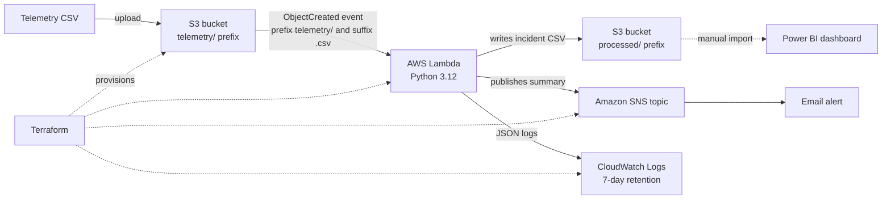
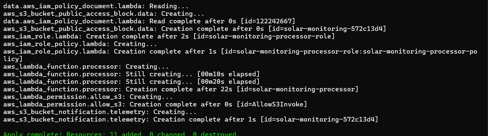
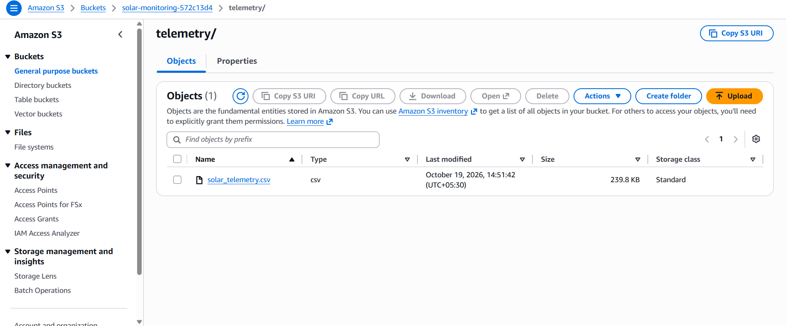
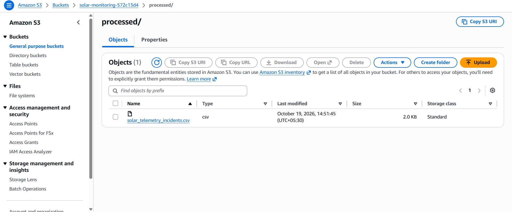
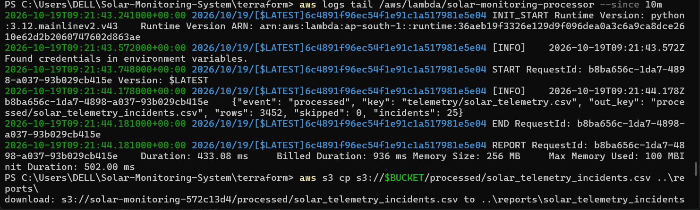

# Solar Asset Monitoring Platform on AWS


An **event-driven, serverless monitoring pipeline** for solar inverter telemetry, provisioned entirely with **Terraform**.
Uploading a CSV to S3 triggers a Python Lambda function that validates and analyses the data, writes an incident register back to S3, and sends an email summary through Amazon SNS.

> **Data notice:** this project uses **synthetic** solar telemetry only. It contains no employer, client or real operational data.

---

## Table of contents

1. [Why this project](#why-this-project)
2. [Architecture](#architecture)
3. [How it works](#how-it-works)
4. [Tech stack](#tech-stack)
5. [Repository structure](#repository-structure)
6. [Infrastructure (Terraform)](#infrastructure-terraform)
7. [Security design](#security-design)
8. [Processing logic and data model](#processing-logic-and-data-model)
9. [Tested results](#tested-results)
10. [Screenshots](#screenshots)
11. [Run it yourself](#run-it-yourself)
12. [Run the tests](#run-the-tests)
13. [Cost and clean-up](#cost-and-clean-up)
14. [Design decisions](#design-decisions)
15. [Known limitations](#known-limitations)
16. [Roadmap](#roadmap)
17. [Skills demonstrated](#skills-demonstrated)
18. [Troubleshooting](#troubleshooting)
19. [Author](#author)

---

## Why this project

Solar asset operators receive large volumes of inverter data and need to spot problems quickly. This project shows how to build that workflow with cloud-native building blocks and DevOps practices:

- **Serverless and event-driven**: no servers to manage; processing starts when a file arrives.
- **Infrastructure as Code**: the whole environment is created and destroyed with Terraform, so it is repeatable and reviewable.
- **Least-privilege security**: private storage and narrowly scoped IAM permissions.
- **Observable**: structured JSON logs in CloudWatch and email alerts through SNS.
- **Tested**: the processing logic is separated from AWS code and covered by unit tests.

---

## Architecture



---

## How it works

1. **Upload.** A telemetry CSV is uploaded to the `telemetry/` prefix of a private S3 bucket.
2. **Trigger.** S3 emits an `ObjectCreated` event. The bucket notification is filtered to the prefix `telemetry/` and the suffix `.csv`.
3. **Process.** The Lambda function reads the **bucket name and object key from the event** (no hard-coded file names), parses and validates every row, and skips malformed rows while counting them.
4. **Detect.** The rules engine evaluates each reading and builds a list of incident records.
5. **Store.** Results are written to `processed/<input-name>_incidents.csv`.
6. **Alert.** If incidents exist, Lambda publishes a summary (rows processed, rows skipped, incident counts by type) to an SNS topic, which emails the subscriber.
7. **Observe.** Each run writes a structured JSON log line to CloudWatch Logs.
8. **Report.** The incident CSV can be imported into Power BI for KPI cards, charts and filters.

**Recursion safety:** the trigger only fires for `telemetry/*.csv`, and Lambda writes only to `processed/`. The function can never invoke itself, and the handler also ignores any key outside `telemetry/` or without a `.csv` extension.

---

## Tech stack

| Area | Tools |
|---|---|
| Cloud | AWS S3, Lambda (Python 3.12), SNS, IAM, CloudWatch Logs |
| Infrastructure as Code | Terraform 1.10+, AWS provider 6.x, remote state in S3 with state locking |
| Language and testing | Python 3.12, pytest, boto3 |
| Reporting | Power BI Desktop, DAX |
| Tooling | AWS CLI v2, Git, GitHub, VS Code |

---

## Repository structure

```text
.
├── README.md
├── requirements-dev.txt          # pytest, boto3 (local development)
├── pytest.ini                    # test configuration
├── src/
│   └── processor/
│       ├── handler.py            # Lambda entry point (S3 event -> S3 + SNS)
│       └── rules.py              # pure functions: parsing, rules, CSV output, summary
├── tests/
│   ├── test_rules.py             # rule boundaries, parsing, end-to-end
│   └── test_handler.py           # recursion and file-type guards
├── terraform/
│   ├── versions.tf               # Terraform + provider versions, S3 backend
│   ├── variables.tf              # alert_email, project
│   ├── main.tf                   # S3, SNS, IAM, Lambda, trigger, log group
│   └── outputs.tf                # bucket name, Lambda name, SNS topic ARN
├── scripts/                      # helpers to generate and validate synthetic data
├── data/
│   └── solar_telemetry.csv       # synthetic telemetry (3,452 rows)
└── reports/
    ├── incident_register.csv     # sample incident output
    ├── solar_telemetry_incidents.csv   # output from the deployed run
    ├── *.pbix                    # Power BI dashboards
    └── screenshots/              # deployment evidence
```

---

## Infrastructure (Terraform)

`terraform apply` creates **11 resources**:

| # | Resource | Purpose |
|---|---|---|
| 1 | `random_id` | Random suffix so the bucket name is globally unique |
| 2 | `aws_s3_bucket` | Holds `telemetry/` input and `processed/` output |
| 3 | `aws_s3_bucket_public_access_block` | All four public-access blocks enabled |
| 4 | `aws_sns_topic` | Alert channel |
| 5 | `aws_sns_topic_subscription` | Email subscription (must be confirmed once) |
| 6 | `aws_cloudwatch_log_group` | Lambda logs with 7-day retention |
| 7 | `aws_iam_role` | Execution role assumed only by Lambda |
| 8 | `aws_iam_role_policy` | Least-privilege permissions (see below) |
| 9 | `aws_lambda_function` | Python 3.12, 256 MB, 30 s timeout, code packaged from `src/processor` |
| 10 | `aws_lambda_permission` | Allows S3 to invoke the function |
| 11 | `aws_s3_bucket_notification` | Trigger on `telemetry/*.csv` object creation |

**Inputs:** `alert_email` (required), `project` (default `solar-monitoring`).
**Outputs:** `bucket_name`, `lambda_name`, `sns_topic_arn`.
**State:** stored in a separate, versioned, private S3 bucket with encryption and lock file (`use_lockfile = true`).

---

## Security design

| Control | Implementation |
|---|---|
| Private storage | S3 Block Public Access enabled on both the data bucket and the state bucket |
| Least privilege | Lambda role can only: read `telemetry/*`, write `processed/*`, publish to one SNS topic, write to one log group |
| No secrets in code | No access keys, tokens or `.env` files in the repository |
| Git hygiene | `*.tfvars`, `*.tfstate`, `.terraform/`, `*.zip` and raw screenshots are git-ignored |
| State protection | Versioned and encrypted state bucket with locking |
| Cost guardrails | AWS Budget alert, 7-day log retention, no VPC or NAT gateway |

---

## Processing logic and data model

### Input columns (CSV)

| Column | Description |
|---|---|
| `timestamp` | Reading time |
| `site_id`, `inverter_id` | Synthetic site and inverter identifiers |
| `ac_power_kw` | AC output power |
| `dc_voltage_v` | DC voltage |
| `inverter_temp_c` | Inverter temperature |
| `ghi_w_m2` | Solar irradiance |
| `energy_kwh_interval` | Energy for the interval |
| `expected_scenario` | Label used by the synthetic data generator |

### Detection rules (demonstration thresholds)

| Incident type | Condition | Severity |
|---|---|---|
| `ZERO_POWER` | Irradiance at least 200 W/m² and AC power at most 1 kW | HIGH |
| `HIGH_TEMPERATURE` | Inverter temperature at least 80 °C | HIGH |
| `MISSING_TELEMETRY` | Gap above 5 minutes between consecutive readings of the same site and inverter | MEDIUM |

These thresholds are illustrative. A production system would need equipment-specific limits, time windows and false-positive review.

### Output columns (`processed/<name>_incidents.csv`)

`timestamp, site_id, inverter_id, incident_type, severity, detail`

---

## Tested results

Deployed with Terraform in `ap-south-1` and tested end to end:

| Check | Result |
|---|---|
| Terraform apply | 11 resources added, 0 changed, 0 destroyed |
| Rows processed | 3,452 |
| Rows skipped | 0 |
| Incident records | 25 (12 `HIGH_TEMPERATURE`, 12 `ZERO_POWER`, 1 `MISSING_TELEMETRY`) |
| Trigger | Automatic: output file appeared in `processed/` within seconds of upload |
| Alert | Email received through SNS |
| Lambda duration | About 433 ms (936 ms billed, including initialisation) |
| Memory used | About 100 MB of 256 MB |
| Unit tests | 15 passing |
| Clean-up | `terraform destroy` removes all resources |

Counts describe incident **records**, not de-duplicated operational incidents.

---

## Screenshots

**Infrastructure created by Terraform**



**Input file in S3 (`telemetry/`)**



**Incident register written by Lambda (`processed/`)**



**Lambda execution log (rows, skipped, incidents)**



**Email alert delivered through SNS**


---

## Run it yourself

### Prerequisites

- An AWS account with an IAM user and `aws configure` completed (region `ap-south-1`)
- AWS CLI v2, Terraform 1.10 or newer, Python 3.12 or newer, Git
- An email address that can receive the SNS confirmation

### 1. Clone

```bash
git clone https://github.com/<your-username>/solar-asset-monitoring.git
cd solar-asset-monitoring
```

### 2. Create the Terraform state bucket (one time)

Choose a globally unique name. PowerShell:

```powershell
$STATE_BUCKET = "solar-tfstate-<unique-suffix>"
aws s3api create-bucket --bucket $STATE_BUCKET --region ap-south-1 --create-bucket-configuration LocationConstraint=ap-south-1
aws s3api put-bucket-versioning --bucket $STATE_BUCKET --versioning-configuration Status=Enabled
aws s3api put-public-access-block --bucket $STATE_BUCKET --public-access-block-configuration BlockPublicAcls=true,IgnorePublicAcls=true,BlockPublicPolicy=true,RestrictPublicBuckets=true
```

Then put the same name in the `backend "s3"` block of `terraform/versions.tf`.

### 3. Set your alert email

Create `terraform/terraform.tfvars` (git-ignored):

```hcl
alert_email = "you@example.com"
```

### 4. Deploy

```powershell
cd terraform
terraform init
terraform validate
terraform plan
terraform apply
```

Expected: `Plan: 11 to add, 0 to change, 0 to destroy.`

### 5. Confirm the email subscription

AWS sends a **Subscription Confirmation** email. Click **Confirm subscription**. Without this, alerts are not delivered.

### 6. Test the pipeline

```powershell
$BUCKET = terraform output -raw bucket_name
aws s3 cp ..\data\solar_telemetry.csv s3://$BUCKET/telemetry/
aws s3 ls s3://$BUCKET/processed/
aws logs tail /aws/lambda/solar-monitoring-processor --since 10m
```

On macOS or Linux use `BUCKET=$(terraform output -raw bucket_name)` and forward slashes in paths.

You should see `solar_telemetry_incidents.csv` in `processed/`, a log line with `"rows": 3452` and `"incidents": 25`, and an alert email.

---

## Run the tests

```bash
pip install -r requirements-dev.txt
python -m pytest -q
```

15 tests: boundary checks for each rule (for example exactly 200 W/m², exactly 80 °C, exactly 5 minutes), unsorted input, per-inverter gap logic, malformed-row handling, CSV output, and handler guards against wrong prefixes and file types.

---

## Cost and clean-up

The design stays inside the AWS Free Tier at this scale: Lambda, SNS email, S3 and CloudWatch Logs usage is tiny, logs expire after 7 days, and there is no NAT gateway or VPC. Charges depend on your account and usage, so set an AWS Budget alert.

Delete everything when you finish:

```powershell
cd terraform
terraform destroy
```

This removes all 11 resources. The state bucket is created manually, so delete it separately if you no longer need it.

---

## Design decisions

| Decision | Reason |
|---|---|
| Rules separated from the Lambda handler (`rules.py`) | Pure functions are easy to unit test without AWS |
| Handler reads bucket and key from the S3 event | Works for any uploaded file instead of one hard-coded name |
| Separate `telemetry/` and `processed/` prefixes with a filtered trigger | Prevents recursive invocations |
| Terraform with remote state, versioning and locking | Safe, repeatable and recoverable infrastructure |
| Inline least-privilege IAM policy scoped to prefixes | Limits the impact of any misconfiguration |
| 7-day log retention | Keeps storage and cost minimal |
| Lambda outside a VPC | No NAT gateway cost and no networking needed for S3 and SNS |
| `force_destroy = true` on the data bucket | Lets `terraform destroy` clean up a demo environment completely |

---

## Known limitations

- Synthetic data and demonstration thresholds only.
- The incident file is overwritten per input file; there is no persistent, de-duplicated incident history yet.
- Power BI is refreshed by manually importing the incident CSV.
- There is no dead-letter queue or error alarm yet, so a failed invocation is only visible in CloudWatch Logs.
- Deployment is manual (`terraform apply` from a laptop) until the CI/CD pipeline is added.

---

## Roadmap

- [x] Event-driven S3 to Lambda to SNS pipeline
- [x] Infrastructure as Code with Terraform and remote state
- [x] Unit tests for processing logic
- [x] Least-privilege IAM and private S3
- [ ] **GitHub Actions CI/CD**: pytest, `terraform fmt`, `validate` and `plan` on pull requests; `terraform apply` on merge to `main`
- [ ] **OIDC authentication** from GitHub to AWS (no stored access keys)
- [ ] **DynamoDB** for idempotent, persistent incident history
- [ ] **CloudWatch alarm** on Lambda errors with SNS notification
- [ ] **SQS dead-letter queue** for failed invocations
- [ ] Architecture diagram export and short demo recording

---

## Skills demonstrated

AWS (S3, Lambda, SNS, IAM, CloudWatch), Terraform and Infrastructure as Code, event-driven architecture, serverless design, least-privilege security, Python, pytest, Git and GitHub, observability and structured logging, cost control on the AWS Free Tier, Power BI and DAX reporting, technical documentation.

---

## Troubleshooting

| Problem | Likely cause and fix |
|---|---|
| `terraform init` cannot reach `registry.terraform.io` | DNS or network issue. Flush DNS, set DNS to 8.8.8.8 and 1.1.1.1, or use another network |
| `Reference to undeclared resource` | A `.tf` file is missing or unsaved (for example `main.tf`) |
| No alert email | The SNS subscription was not confirmed. Click the link in the confirmation email, then upload the CSV again |
| Nothing in `processed/` | Upload to the `telemetry/` prefix with a `.csv` extension, then check the CloudWatch log group |
| `BucketAlreadyExists` for the state bucket | Bucket names are global. Choose a different suffix |
| `Repository not found` on `git push` | Wrong username or repository name in the remote URL. Check `git remote -v` |

---

## Author

**Rushikesh Gokhe**: Cloud, DevOps and Python automation
[LinkedIn](https://linkedin.com/in/rushikeshgokhe) · [GitHub](https://github.com/rushikeshgokhe)

<!-- CI test -->
