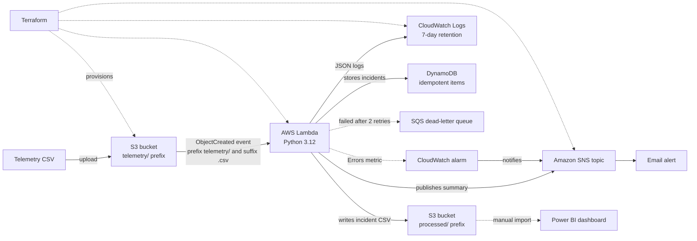
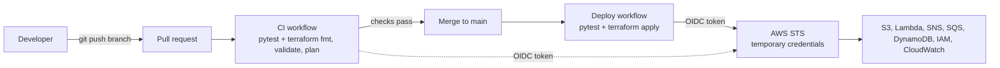
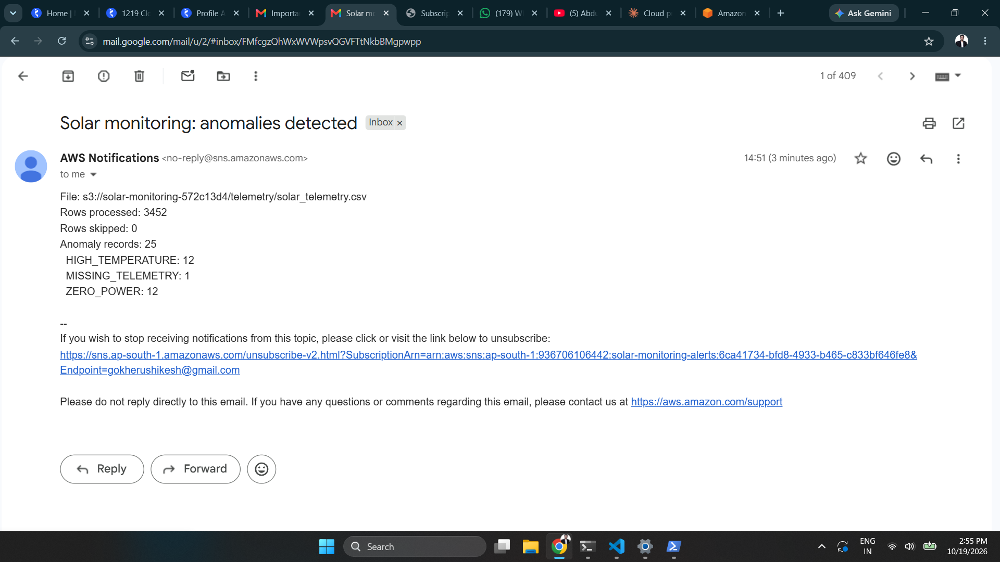

[README_final.md](https://github.com/user-attachments/files/34068054/README_final.md)

# Solar Asset Monitoring Platform on AWS


An **event-driven, serverless monitoring pipeline** for solar inverter telemetry, provisioned entirely with **Terraform**.
Uploading a CSV to S3 triggers a Python Lambda function that validates and analyses the data, writes an incident register back to S3, and sends an email summary through Amazon SNS.
Every change is tested and deployed automatically by **GitHub Actions**, which signs in to AWS with **OpenID Connect (OIDC)**, so no AWS access keys are stored anywhere.

> **Data notice:** this project uses **synthetic** solar telemetry only. It contains no employer, client or real operational data.

---

## Table of contents

1. [Why this project](#why-this-project)
2. [Architecture](#architecture)
3. [How it works](#how-it-works)
4. [Tech stack](#tech-stack)
5. [Build journey, start to end](#build-journey-start-to-end)
6. [Repository structure](#repository-structure)
7. [Infrastructure (Terraform)](#infrastructure-terraform)
8. [CI/CD pipeline](#cicd-pipeline)
9. [Security design](#security-design)
10. [Processing logic and data model](#processing-logic-and-data-model)
11. [Tested results](#tested-results)
12. [Screenshots](#screenshots)
13. [Run it yourself](#run-it-yourself)
14. [Run the tests](#run-the-tests)
15. [Cost and clean-up](#cost-and-clean-up)
16. [Design decisions](#design-decisions)
17. [Challenges and how I solved them](#challenges-and-how-i-solved-them)
18. [Known limitations](#known-limitations)
19. [Roadmap](#roadmap)
20. [Skills demonstrated](#skills-demonstrated)
21. [Troubleshooting](#troubleshooting)
22. [Author](#author)

---

## Why this project

Solar asset operators receive large volumes of inverter data and need to spot problems quickly. This project shows how to build that workflow with cloud-native building blocks and DevOps practices:

- **Serverless and event-driven**: no servers to manage; processing starts when a file arrives.
- **Infrastructure as Code**: the whole environment is created and destroyed with Terraform, so it is repeatable and reviewable.
- **Least-privilege security**: private storage and narrowly scoped IAM permissions.
- **Observable**: structured JSON logs in CloudWatch and email alerts through SNS.
- **Reliable**: failed events land in a dead-letter queue, a CloudWatch alarm emails on errors, and incident history is stored in DynamoDB without duplicates.
- **Tested**: the processing logic is separated from AWS code and covered by unit tests.

---

## Architecture



---

## How it works

1. **Upload.** A telemetry CSV is uploaded to the `telemetry/` prefix of a private S3 bucket.
2. **Trigger.** S3 emits an `ObjectCreated` event. The bucket notification is filtered to the prefix `telemetry/` and the suffix `.csv`.
3. **Process.** The Lambda function reads the **bucket name and object key from the event** (no hard-coded file names), parses and validates every row, and skips malformed rows while counting them.
4. **Detect.** The rules engine evaluates each reading and builds a list of incident records.
5. **Store.** Results are written to `processed/<input-name>_incidents.csv`.
6. **Persist.** Each incident is written to a DynamoDB table. The key is built from site, inverter, timestamp and incident type, so processing the same file twice overwrites items instead of duplicating them.
7. **Alert.** If incidents exist, Lambda publishes a summary (rows processed, rows skipped, incident counts by type) to an SNS topic, which emails the subscriber.
8. **Observe.** Each run writes a structured JSON log line to CloudWatch Logs, and a CloudWatch alarm emails you through SNS when the function reports an error.
9. **Recover.** If an invocation still fails after two retries, the event is sent to an SQS dead-letter queue (14-day retention) for inspection.
10. **Report.** The incident CSV can be imported into Power BI for KPI cards, charts and filters.

**Recursion safety:** the trigger only fires for `telemetry/*.csv`, and Lambda writes only to `processed/`. The function can never invoke itself, and the handler also ignores any key outside `telemetry/` or without a `.csv` extension.

---

## Tech stack

| Area | Tools |
|---|---|
| Cloud | AWS S3, Lambda (Python 3.12), SNS, SQS, DynamoDB, IAM, CloudWatch (Logs and Alarms) |
| Infrastructure as Code | Terraform 1.10+, AWS provider 6.x, remote state in S3 with state locking |
| CI/CD | GitHub Actions, OpenID Connect (OIDC) role assumption, pytest in the pipeline |
| Language and testing | Python 3.12, pytest, boto3 |
| Reporting | Power BI Desktop, DAX |
| Tooling | AWS CLI v2, Git, GitHub, VS Code |

---

## Build journey, start to end

The project was built in nine steps. Each step was finished and verified before the next one began.

| Step | What I did | Tools | Outcome |
|---|---|---|---|
| 1 | Installed the tooling | AWS CLI v2, Terraform, Git, Python | All four `--version` checks worked |
| 2 | Secured the AWS account and connected the laptop | MFA, IAM user, AWS Budget, `aws configure` | `aws sts get-caller-identity` returned my identity |
| 3 | Refactored the processing logic into pure functions and wrote tests | Python, pytest | 15 tests passing; 3,452 rows analysed locally with 25 incident records |
| 4 | Created the Terraform foundation | S3 state bucket (private, versioned), S3 backend with lock file | `terraform init` and `validate` succeeded |
| 5 | Wrote the core infrastructure as code | Terraform | Plan of 11 resources: S3, SNS, IAM, Lambda, S3 trigger, log group |
| 6 | Applied, tested end to end, captured evidence, destroyed | Terraform, AWS CLI | CSV in, incident register and email out, then everything removed |
| 7 | Published the repository | Git, GitHub | Public repository with README and screenshots |
| 8 | Built CI/CD with keyless login | GitHub Actions, OIDC, a bootstrap Terraform folder | Pull-request checks, automatic deploy on merge and a manual destroy button, all green |
| 9 | Added reliability | DynamoDB, SQS dead-letter queue, CloudWatch alarm | 20 tests, 16 resources; failed event reached the queue and the alarm fired |

Steps 4 to 6 produced the core platform, step 8 made it automatic, and step 9 made it dependable.

---

## Repository structure

```text
.
├── README.md
├── requirements-dev.txt          # pytest, boto3 (local development)
├── pytest.ini                    # test configuration
├── .github/workflows/
│   ├── ci.yml                    # pull requests: tests + terraform fmt, validate, plan
│   ├── deploy.yml                # push to main: tests + terraform apply
│   └── destroy.yml               # manual only: terraform destroy (type "destroy" to confirm)
├── bootstrap/
│   └── main.tf                   # one-time: GitHub OIDC provider + least-privilege deploy role
├── src/
│   └── processor/
│       ├── handler.py            # Lambda entry point (S3 event -> S3 + DynamoDB + SNS)
│       └── rules.py              # pure functions: parsing, rules, CSV output, summary
├── tests/
│   ├── test_rules.py             # rule boundaries, parsing, end-to-end
│   ├── test_handler.py           # recursion and file-type guards
│   └── test_reliability.py       # DynamoDB item keys, idempotency, storage logic
├── terraform/
│   ├── versions.tf               # Terraform + provider versions, S3 backend
│   ├── variables.tf              # alert_email, project
│   ├── main.tf                   # S3, SNS, IAM, Lambda, trigger, log group
│   ├── reliability.tf            # DynamoDB, SQS dead-letter queue, failure routing, alarm
│   └── outputs.tf                # bucket name, Lambda name, SNS topic ARN
├── scripts/                      # helpers to generate and validate synthetic data
├── data/
│   └── solar_telemetry.csv       # synthetic telemetry (3,452 rows)
└── reports/
    ├── incident_register.csv     # sample incident output
    ├── solar_telemetry_incidents.csv   # output from the deployed run
    ├── *.pbix                    # Power BI dashboards
    └── screenshots/              # deployment evidence
```

---

## Infrastructure (Terraform)

`terraform apply` creates **16 resources**:

| # | Resource | Purpose |
|---|---|---|
| 1 | `random_id` | Random suffix so the bucket name is globally unique |
| 2 | `aws_s3_bucket` | Holds `telemetry/` input and `processed/` output |
| 3 | `aws_s3_bucket_public_access_block` | All four public-access blocks enabled |
| 4 | `aws_sns_topic` | Alert channel |
| 5 | `aws_sns_topic_subscription` | Email subscription (must be confirmed once) |
| 6 | `aws_cloudwatch_log_group` | Lambda logs with 7-day retention |
| 7 | `aws_iam_role` | Execution role assumed only by Lambda |
| 8 | `aws_iam_role_policy` | Least-privilege permissions (see below) |
| 9 | `aws_lambda_function` | Python 3.12, 256 MB, 30 s timeout, code packaged from `src/processor` |
| 10 | `aws_lambda_permission` | Allows S3 to invoke the function |
| 11 | `aws_s3_bucket_notification` | Trigger on `telemetry/*.csv` object creation |
| 12 | `aws_dynamodb_table` | On-demand table `solar-monitoring-incidents`, keyed by site and inverter plus timestamp and incident type |
| 13 | `aws_sqs_queue` | Dead-letter queue, encrypted, 14-day retention |
| 14 | `aws_iam_role_policy` (second) | Adds `dynamodb:PutItem` and `BatchWriteItem` on the table and `sqs:SendMessage` on the queue |
| 15 | `aws_lambda_function_event_invoke_config` | Two retries, then failed events go to the dead-letter queue |
| 16 | `aws_cloudwatch_metric_alarm` | Notifies through SNS when the function reports errors |

**Inputs:** `alert_email` (required), `project` (default `solar-monitoring`).
**Outputs:** `bucket_name`, `lambda_name`, `sns_topic_arn`, `incidents_table`, `dlq_url`.
**State:** stored in a separate, versioned, private S3 bucket with encryption and lock file (`use_lockfile = true`).

**Bootstrap:** the GitHub login (OIDC provider, deploy role and its policy, 3 resources) lives in its own folder, `bootstrap/`, with its own state. It is applied once from a laptop, so the pipeline never manages, and can never destroy, its own credentials.

---

## CI/CD pipeline



| Workflow | Trigger | What it does |
|---|---|---|
| `ci.yml` | Pull request to `main` | Job 1: pytest. Job 2: OIDC login, `terraform fmt -check`, `init`, `validate`, `plan`. Changes nothing in AWS. |
| `deploy.yml` | Push to `main` (when `src/`, `terraform/` or the workflow changes), or manual | pytest, then `terraform plan -out`, then `terraform apply` of that exact plan. Runs one at a time (`concurrency`). |
| `destroy.yml` | Manual only | Requires typing `destroy`. Runs `terraform destroy`. |

**How the login works (no stored keys)**

1. GitHub issues a short-lived signed token for each workflow run.
2. AWS trusts GitHub's OIDC provider and checks the token's subject. The trust policy accepts only this repository, identified by owner ID and repository ID, and only the `main` branch or pull requests.
3. AWS returns temporary credentials for the role `github-actions-solar-monitoring`, which can only manage `solar-monitoring-*` resources.
4. The credentials expire when the job ends.

**Repository secrets used:** `AWS_ROLE_ARN`, `ALERT_EMAIL`, `AWS_ACCOUNT_ID` (the last one is referenced so GitHub masks it in public logs). None of them is an access key.

## Security design

| Control | Implementation |
|---|---|
| Private storage | S3 Block Public Access enabled on both the data bucket and the state bucket |
| No stored AWS keys | GitHub Actions gets short-lived credentials through OIDC |
| Scoped deploy role | Trust policy pinned to the repository's owner ID and repo ID, `main` branch and pull requests only. Permissions limited to `solar-monitoring-*` resources. The role cannot edit its own permissions |
| Least privilege | Lambda role can only: read `telemetry/*`, write `processed/*`, publish to one SNS topic, write to one log group, write items to one DynamoDB table, send messages to one queue |
| No secrets in code | No access keys, tokens or `.env` files in the repository |
| Git hygiene | `*.tfvars`, `*.tfstate`, `.terraform/`, `*.zip` and raw screenshots are git-ignored |
| State protection | Versioned and encrypted state bucket with locking |
| Cost guardrails | AWS Budget alert, 7-day log retention, no VPC or NAT gateway |

---

## Processing logic and data model

### Input columns (CSV)

| Column | Description |
|---|---|
| `timestamp` | Reading time |
| `site_id`, `inverter_id` | Synthetic site and inverter identifiers |
| `ac_power_kw` | AC output power |
| `dc_voltage_v` | DC voltage |
| `inverter_temp_c` | Inverter temperature |
| `ghi_w_m2` | Solar irradiance |
| `energy_kwh_interval` | Energy for the interval |
| `expected_scenario` | Label used by the synthetic data generator |

### Detection rules (demonstration thresholds)

| Incident type | Condition | Severity |
|---|---|---|
| `ZERO_POWER` | Irradiance at least 200 W/m² and AC power at most 1 kW | HIGH |
| `HIGH_TEMPERATURE` | Inverter temperature at least 80 °C | HIGH |
| `MISSING_TELEMETRY` | Gap above 5 minutes between consecutive readings of the same site and inverter | MEDIUM |

These thresholds are illustrative. A production system would need equipment-specific limits, time windows and false-positive review.

### Output columns (`processed/<name>_incidents.csv`)

`timestamp, site_id, inverter_id, incident_type, severity, detail`

---

## Tested results

Deployed with Terraform in `ap-south-1` and tested end to end:

| Check | Result |
|---|---|
| Terraform apply | 16 resources created through the GitHub Actions Deploy workflow |
| Rows processed | 3,452 |
| Rows skipped | 0 |
| Incident records | 25 (12 `HIGH_TEMPERATURE`, 12 `ZERO_POWER`, 1 `MISSING_TELEMETRY`) |
| Trigger | Automatic: output file appeared in `processed/` within seconds of upload |
| Alert | Email received through SNS |
| Lambda duration | About 433 ms (936 ms billed, including initialisation) |
| Memory used | About 100 MB of 256 MB |
| Unit tests | 20 passing |
| Incident history | 25 incident items stored in DynamoDB. Re-processing is idempotent by design: the same incident always maps to the same key, covered by unit tests |
| Failure handling | A deliberately unreadable file failed after retries and its event landed in the dead-letter queue |
| Alarm | CloudWatch alarm changed from OK to ALARM on the failed invocation |
| Deploy workflow | Green: tests passed, then plan and apply created the resources through OIDC |
| Pull-request check | Green: pytest and Terraform plan passed (`No changes`) before merge |
| Destroy workflow | Green: all resources removed from AWS |
| Clean-up | `terraform destroy` (local or from the Destroy workflow) removes all resources |

Each incident record is stored once in DynamoDB under a stable key, so the table holds a de-duplicated history.

---

## Screenshots

**GitHub Actions: Deploy, CI and Destroy runs**


**Deploy workflow, all steps green after the fix**


**Infrastructure created by Terraform**


**Input file in S3 (`telemetry/`)**


**Incident register written by Lambda (`processed/`)**


**Lambda execution log (rows, skipped, incidents)**


**Email alert delivered through SNS**



---

## Run it yourself

### Prerequisites

- An AWS account with an IAM user and `aws configure` completed (region `ap-south-1`)
- AWS CLI v2, Terraform 1.10 or newer, Python 3.12 or newer, Git
- An email address that can receive the SNS confirmation

### 1. Clone

```bash
git clone https://github.com/<your-username>/solar-asset-monitoring.git
cd solar-asset-monitoring
```

### 2. Create the Terraform state bucket (one time)

Choose a globally unique name. PowerShell:

```powershell
$STATE_BUCKET = "solar-tfstate-<unique-suffix>"
aws s3api create-bucket --bucket $STATE_BUCKET --region ap-south-1 --create-bucket-configuration LocationConstraint=ap-south-1
aws s3api put-bucket-versioning --bucket $STATE_BUCKET --versioning-configuration Status=Enabled
aws s3api put-public-access-block --bucket $STATE_BUCKET --public-access-block-configuration BlockPublicAcls=true,IgnorePublicAcls=true,BlockPublicPolicy=true,RestrictPublicBuckets=true
```

Then put the same name in the `backend "s3"` block of `terraform/versions.tf`.

### 3. Set your alert email

Create `terraform/terraform.tfvars` (git-ignored):

```hcl
alert_email = "you@example.com"
```

### 4. Deploy

```powershell
cd terraform
terraform init
terraform validate
terraform plan
terraform apply
```

Expected: `Plan: 11 to add, 0 to change, 0 to destroy.`

### 5. Confirm the email subscription

AWS sends a **Subscription Confirmation** email. Click **Confirm subscription**. Without this, alerts are not delivered.

### 6. Test the pipeline

```powershell
$BUCKET = terraform output -raw bucket_name
aws s3 cp ..\data\solar_telemetry.csv s3://$BUCKET/telemetry/
aws s3 ls s3://$BUCKET/processed/
aws logs tail /aws/lambda/solar-monitoring-processor --since 10m
```

On macOS or Linux use `BUCKET=$(terraform output -raw bucket_name)` and forward slashes in paths.

### Optional: deploy through the CI/CD pipeline

1. In `bootstrap/main.tf`, set the backend `bucket` to your state bucket and `github_repo` to your own `owner@<owner-id>/repo@<repo-id>` value (see Troubleshooting). Create `bootstrap/terraform.tfvars` with `state_bucket = "<your-state-bucket>"`.
2. Run `terraform init` and `terraform apply` inside `bootstrap/`. Copy the `github_actions_role_arn` output.
3. In your GitHub repository, add the secrets `AWS_ROLE_ARN`, `ALERT_EMAIL` and `AWS_ACCOUNT_ID`.
4. Push to `main`. The Deploy workflow creates the infrastructure. Use the Destroy workflow to remove it.

You should see `solar_telemetry_incidents.csv` in `processed/`, a log line with `"rows": 3452` and `"incidents": 25`, and an alert email.

---

## Run the tests

```bash
pip install -r requirements-dev.txt
python -m pytest -q
```

20 tests: boundary checks for each rule (for example exactly 200 W/m², exactly 80 °C, exactly 5 minutes), unsorted input, per-inverter gap logic, malformed-row handling, CSV output, handler guards against wrong prefixes and file types, and the DynamoDB item keys, idempotent keys and storage logic (tested with a fake table, so no AWS is needed).

---

## Cost and clean-up

The design is built for the AWS Free Tier at this scale: Lambda, SNS email, SQS, S3 and CloudWatch usage is tiny, DynamoDB uses on-demand billing (no idle charge, about 25 writes per test file), logs expire after 7 days, and there is no NAT gateway or VPC. Charges depend on your account and usage, so set an AWS Budget alert.

Delete everything when you finish:

```powershell
cd terraform
terraform destroy
```

This removes all 16 resources. The state bucket is created manually, so delete it separately if you no longer need it.

---

## Design decisions

| Decision | Reason |
|---|---|
| Rules separated from the Lambda handler (`rules.py`) | Pure functions are easy to unit test without AWS |
| Handler reads bucket and key from the S3 event | Works for any uploaded file instead of one hard-coded name |
| Separate `telemetry/` and `processed/` prefixes with a filtered trigger | Prevents recursive invocations |
| Terraform with remote state, versioning and locking | Safe, repeatable and recoverable infrastructure |
| Inline least-privilege IAM policy scoped to prefixes | Limits the impact of any misconfiguration |
| 7-day log retention | Keeps storage and cost minimal |
| Lambda outside a VPC | No NAT gateway cost and no networking needed for S3 and SNS |
| `force_destroy = true` on the data bucket | Lets `terraform destroy` clean up a demo environment completely |
| DynamoDB key from site, inverter, timestamp and incident type, written with overwrite | The same incident always maps to the same item, so reruns are idempotent |
| DynamoDB on-demand billing | No idle cost and no capacity planning at this scale |
| Lambda on-failure destination to SQS with two retries | Failed events are kept for 14 days instead of being lost |
| Alarm on the Lambda `Errors` metric with a 1-minute period | Fast notification of any failing invocation |

---

## Challenges and how I solved them

| Challenge | Cause | How I solved it |
|---|---|---|
| `terraform init` could not download providers | The home router's DNS was not answering. Pings worked, but name lookups failed | Compared lookups against my router and against 8.8.8.8, then set DNS to 8.8.8.8 and 1.1.1.1 on the Wi-Fi connection that was actually in use |
| GitHub Actions could not assume the AWS role (`Not authorized to perform sts:AssumeRoleWithWebIdentity`) | GitHub's token subject now contains numeric owner and repository IDs, while my trust rule expected the older name-only format | Read the real subject from the CloudTrail record of the failed login, then pinned the trust rule to the exact IDs. This is also more secure |
| Deploy failed creating the DynamoDB table (`Credentials-sourced account ID parameter is invalid`) | DynamoDB is the first AWS service whose endpoint can use the account ID, which the AWS SDK reads from an environment variable named `AWS_ACCOUNT_ID`. My workflow used that name for a log-masking secret | Renamed my variable to `ACCOUNT_ID_MASK` and re-saved the secret without hidden whitespace. Terraform's state meant the next run only created what was missing |
| Pushes rejected with "fetch first" | Files had been added through the GitHub website, so GitHub held commits my laptop did not | `git pull --rebase`, never `--force`. Afterwards I added and pushed only from the laptop |
| Duplicate Terraform resources and a doubled environment variable | The same code ended up in two files, and a pasted block landed on top of an existing line | One file per topic, `git diff` before every commit, and `terraform fmt` plus `validate` before pushing |
| Private details in screenshots | Console pages show the account number and browser tabs | Cropped every screenshot, moved raw captures out of the repository and added them to `.gitignore` |

**What I took from it:** read the whole error message, find the real evidence (CloudTrail, `git diff`, `terraform plan`) before changing anything, work on a branch, and never name your own variables like variables the cloud tools read.

---

## Known limitations

- Synthetic data and demonstration thresholds only.
- The incident CSV is overwritten per input file; the DynamoDB table holds the full de-duplicated history.
- Power BI is refreshed by manually importing the incident CSV.
- The dead-letter queue is not drained automatically; failed events need manual inspection and replay.
- One deploy role serves both pull-request plans and applies on `main`. A stricter design would give pull requests a read-only role.

---

## Roadmap

- [x] Event-driven S3 to Lambda to SNS pipeline
- [x] Infrastructure as Code with Terraform and remote state
- [x] Unit tests for processing logic
- [x] Least-privilege IAM and private S3
- [x] **GitHub Actions CI/CD**: pytest, `terraform fmt`, `validate` and `plan` on pull requests; `terraform apply` on merge to `main`
- [x] **OIDC authentication** from GitHub to AWS (no stored access keys)
- [x] **DynamoDB** for idempotent, persistent incident history
- [x] **CloudWatch alarm** on Lambda errors with SNS notification
- [x] **SQS dead-letter queue** for failed invocations
- [ ] Read-only deploy role for pull requests
- [ ] Dashboard that reads directly from DynamoDB
- [ ] Short demo recording

---

## Skills demonstrated

AWS (S3, Lambda, SNS, SQS, DynamoDB, IAM, CloudWatch), Terraform and Infrastructure as Code, GitHub Actions CI/CD with OIDC, event-driven architecture, serverless design, least-privilege security, Python, pytest, Git and GitHub, observability and structured logging, cost control on the AWS Free Tier, Power BI and DAX reporting, technical documentation.

---

## Troubleshooting

| Problem | Likely cause and fix |
|---|---|
| `terraform init` cannot reach `registry.terraform.io` | DNS or network issue. Flush DNS, set DNS to 8.8.8.8 and 1.1.1.1, or use another network |
| `Reference to undeclared resource` | A `.tf` file is missing or unsaved (for example `main.tf`) |
| No alert email | The SNS subscription was not confirmed. Click the link in the confirmation email, then upload the CSV again |
| Nothing in `processed/` | Upload to the `telemetry/` prefix with a `.csv` extension, then check the CloudWatch log group |
| `BucketAlreadyExists` for the state bucket | Bucket names are global. Choose a different suffix |
| `Not authorized to perform sts:AssumeRoleWithWebIdentity` in GitHub Actions | The trust rule must match the token's subject exactly. It now contains numeric IDs: `repo:<owner>@<owner-id>/<repo>@<repo-id>:ref:refs/heads/main`. Read the real value from CloudTrail (`AssumeRoleWithWebIdentity` events) and update `bootstrap/main.tf` |
| `Credentials-sourced account ID parameter is invalid` on DynamoDB `CreateTable` | The AWS SDK reads an environment variable named `AWS_ACCOUNT_ID`. Do not use `AWS_*` names for your own variables (this repo uses `ACCOUNT_ID_MASK`), and keep secrets free of spaces and line breaks |
| `Repository not found` on `git push` | Wrong username or repository name in the remote URL. Check `git remote -v` |

---

## Author

**Rushikesh Gokhe**: Cloud, DevOps and Python automation
[LinkedIn](https://linkedin.com/in/rushikeshgokhe) · [GitHub](https://github.com/rushikeshgokhe)
