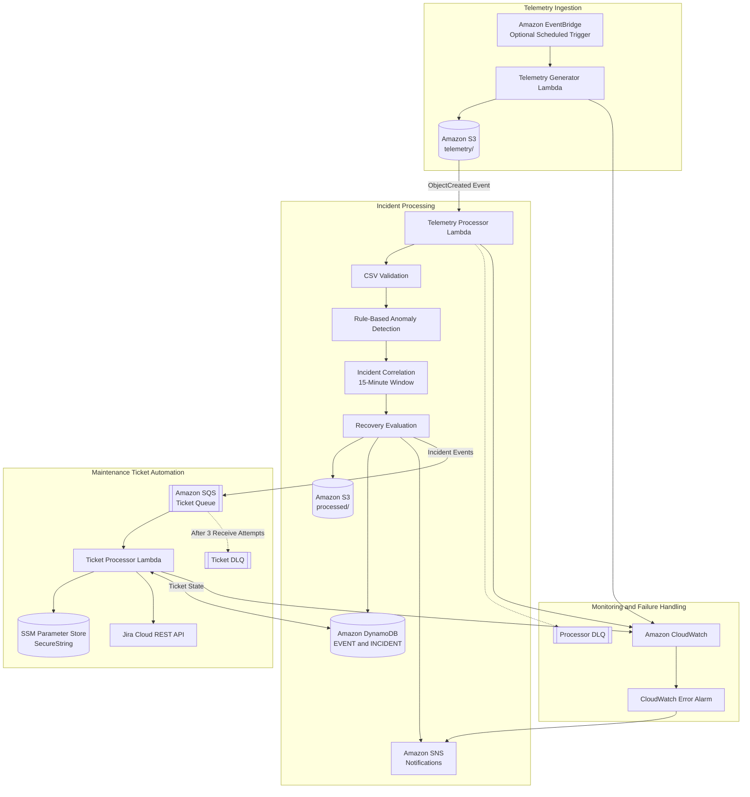

# Cloud-Native Solar Asset Monitoring & Intelligent Incident Automation Platform

**A serverless, event-driven monitoring and incident automation platform built using AWS, Python, Terraform, GitHub Actions and Jira Cloud.**

The platform automates solar telemetry ingestion, anomaly detection, incident correlation, recovery tracking, notifications and maintenance ticket creation.

**Repository:** [solar-asset-monitoring](https://github.com/rushikeshgokhe/solar-asset-monitoring)

---

## 1. Project Overview

Solar power plants consist of multiple sites, inverters and data loggers that continuously generate operational telemetry. Identifying equipment abnormalities and coordinating maintenance activities across these assets can involve significant manual monitoring and incident management.

This project addresses that challenge through a cloud-native, serverless architecture that automates the monitoring and incident management workflow.

Simulated solar telemetry is generated and uploaded to Amazon S3, where event-driven AWS Lambda functions validate incoming data, detect operational anomalies and manage incident lifecycles. Amazon DynamoDB maintains event and incident records, while Amazon SNS provides notifications.

For maintenance automation, incident events are processed asynchronously through Amazon SQS and integrated with Jira Cloud to create and track maintenance issues.

The infrastructure is provisioned using Terraform, with GitHub Actions providing automated validation and deployment through AWS OIDC authentication.

### Key Capabilities

- Automated telemetry generation and S3 ingestion.
- Python-based data validation and anomaly detection.
- Incident correlation and duplicate protection.
- Incident lifecycle and recovery management.
- Persistent event and incident storage using DynamoDB.
- Automated email notifications using SNS.
- Asynchronous maintenance ticket automation using SQS and Jira Cloud.
- Failure handling through retries and dead-letter queues.
- Infrastructure provisioning using Terraform.
- CI/CD automation using GitHub Actions and AWS OIDC.

---

## 2. Architecture

The application follows an event-driven architecture that separates telemetry ingestion, incident processing and maintenance ticket automation.

### Architecture Diagram



### Processing Flow

1. The telemetry generator creates simulated inverter readings.
2. Generated CSV files are uploaded to the S3 `telemetry/` prefix.
3. S3 ObjectCreated events invoke the telemetry processor Lambda.
4. Incoming data is validated and evaluated against anomaly detection rules.
5. Related detections are correlated into normalized incidents.
6. Incident and event records are persisted in DynamoDB.
7. Recovery logic evaluates active incidents against consecutive healthy readings.
8. SNS sends processing and incident notifications.
9. Incident events are delivered to an SQS ticket queue.
10. The ticket processor Lambda communicates with Jira Cloud and maintains ticket state.
11. CloudWatch captures execution logs and monitors application errors.
12. Failed messages are isolated through configured dead-letter queues.

EventBridge supports optional scheduled telemetry generation.

---

## 3. Technology Stack

| Category | Technologies |
|---|---|
| Cloud Platform | AWS |
| Serverless Compute | AWS Lambda |
| Object Storage | Amazon S3 |
| NoSQL Database | Amazon DynamoDB |
| Message Queue | Amazon SQS |
| Notifications | Amazon SNS |
| Event Scheduling | Amazon EventBridge |
| Monitoring and Logging | Amazon CloudWatch |
| Credential Management | AWS Systems Manager Parameter Store |
| Programming Language | Python |
| Ticket Management | Jira Cloud REST API |
| Infrastructure as Code | Terraform |
| CI/CD | GitHub Actions |
| Cloud Authentication | AWS IAM and OIDC |
| Automated Testing | Pytest |
| Version Control | Git and GitHub |

---

## 4. Application Components

### 4.1 Telemetry Generation and Ingestion

A Python-based generator produces simulated solar inverter telemetry in CSV format.

**Simulation environment:**

- 4 solar sites.
- 3 inverters per site.
- 12 inverters overall.
- 5-minute telemetry intervals.

The generated files are uploaded to Amazon S3, which acts as the entry point for the event-driven processing pipeline.

### 4.2 Data Validation and Anomaly Detection

The telemetry processor validates incoming CSV files before applying predefined operational detection rules.

The implemented anomaly categories are:

| Anomaly Type | Detection Rule | Severity |
|---|---|---|
| ZERO_POWER | GHI >= 200 W/m² and AC power <= 1 kW | HIGH |
| HIGH_TEMPERATURE | Inverter temperature >= 80°C | HIGH |
| MISSING_TELEMETRY | Telemetry gap greater than 5 minutes | MEDIUM |

The detection engine uses Python-based threshold rules rather than machine learning.

### 4.3 Incident Correlation and Lifecycle Management

Repeated anomaly detections are evaluated using a 15-minute correlation window.

This allows the system to group related detections into an ongoing incident instead of unnecessarily creating a separate incident for every repeated observation.

The incident lifecycle is managed through:

**NEW → OPEN → RESOLVED**

The recovery module evaluates consecutive healthy telemetry readings before resolving an active incident.

### 4.4 Event and Incident Persistence

Amazon DynamoDB stores application event and incident records.

The data model separates individual anomaly events from normalized incident records.

Conditional and transactional operations support consistent updates and duplicate protection.

### 4.5 Maintenance Ticket Automation

The ticket automation workflow integrates AWS event processing with Jira Cloud.

Incident events are delivered to Amazon SQS and consumed by the dedicated ticket processor Lambda.

The processor:

- Retrieves Jira credentials from SSM Parameter Store SecureString.
- Communicates with Jira Cloud through its REST API.
- Creates or updates maintenance issues.
- Tracks ticket-processing state in DynamoDB.
- Uses asynchronous processing to isolate ticket automation from telemetry ingestion.

**Verified Jira execution:**

| Jira Issue | Incident | Severity |
|---|---|---|
| KAN-5 | ZERO_POWER - SITE-104 - INV-03 | HIGH |
| KAN-6 | HIGH_TEMPERATURE - SITE-102 - INV-01 | HIGH |

These issues were created automatically through the AWS-to-Jira integration workflow.

### 4.6 Notifications and Failure Handling

Amazon SNS sends email notifications containing telemetry processing summaries and incident information.

Amazon SQS decouples maintenance ticket processing from the main telemetry workflow.

Dead-letter queues isolate messages that cannot be processed successfully after the configured retry attempts.

CloudWatch provides centralized execution logs and error monitoring.

---

## 5. AWS Infrastructure and Design

The infrastructure is designed around managed AWS services to reduce operational overhead and support independent processing components.

| Service | Implementation |
|---|---|
| Amazon S3 | Raw telemetry and processed results |
| AWS Lambda | Generator, telemetry processor and ticket processor |
| Amazon DynamoDB | Event, incident and ticket-state persistence |
| Amazon SQS | Asynchronous ticket processing |
| Amazon SNS | Incident and error notifications |
| Amazon EventBridge | Optional scheduled execution |
| Amazon CloudWatch | Logs, metrics and error monitoring |
| AWS IAM | Service permissions and access control |
| AWS Systems Manager | Secure Jira credential storage |

**AWS Region:** `ap-south-1` (Mumbai)

### Infrastructure as Code

Terraform manages the AWS application infrastructure.

The infrastructure configuration includes compute resources, storage, messaging, database, notification, monitoring and IAM components.

A separate S3 backend is used for Terraform remote state management with native state locking.

Infrastructure can be deployed and destroyed through controlled Terraform and GitHub Actions workflows.

---

## 6. CI/CD and Deployment Automation

GitHub Actions automates application validation and infrastructure workflows.

### Workflow Files

| Workflow | Responsibility |
|---|---|
| `ci.yml` | Python tests and Terraform validation |
| `deploy.yml` | AWS infrastructure deployment |
| `destroy.yml` | Controlled infrastructure teardown |

### CI Pipeline

The CI workflow includes:

- Python environment setup.
- Dependency installation.
- Automated Pytest execution.
- Terraform formatting validation.
- Terraform initialization and validation.
- Terraform plan generation.

### AWS Authentication

GitHub Actions uses AWS IAM OIDC federation to obtain temporary AWS credentials.

This avoids depending on long-lived AWS access keys stored in repository secrets.

### Infrastructure Lifecycle

A dedicated destroy workflow supports controlled removal of application resources after testing and demonstrations.

Terraform bootstrap resources, including remote state infrastructure, are managed separately.

---

## 7. Reliability and Engineering Practices

The platform incorporates engineering practices intended to improve reliability and maintainability.

| Engineering Practice | Implementation |
|---|---|
| Event-driven processing | S3 event notifications and Lambda |
| Incident correlation | 15-minute correlation window |
| Duplicate protection | DynamoDB conditional and transactional operations |
| Recovery management | Consecutive healthy-reading evaluation |
| Asynchronous execution | Amazon SQS |
| Failure isolation | Dead-letter queues |
| Retry handling | Configured SQS redrive policy |
| Secure authentication | IAM and GitHub OIDC |
| Credential protection | SSM Parameter Store SecureString |
| Infrastructure management | Terraform |
| Automated validation | GitHub Actions and Pytest |

---

## 8. Project Structure

```text
solar-asset-monitoring/
│
├── .github/
│   └── workflows/
│       ├── ci.yml
│       ├── deploy.yml
│       └── destroy.yml
│
├── src/
│   ├── generator/
│   ├── processor/
│   └── ticket_processor/
│
├── data/
│
├── terraform/
│
├── tests/
│
├── reports/
│   └── screenshots/
│       ├── 06-jira-ticket-kan5.png
│       └── 07-jira-ticket-kan6.png
│
├── requirements.txt
├── requirements-dev.txt
├── pytest.ini
├── .gitignore
└── README.md
```

---

## 9. Testing and Execution Results

Pytest is used to validate the application's processing and business logic.

The test suite covers:

- Telemetry validation.
- Anomaly detection.
- Incident normalization.
- Incident correlation.
- Repository operations.
- Duplicate event handling.
- Recovery evaluation.
- Ticket processing logic.

**Latest recorded automated test result: 61 passed.**

### Historical Dataset Results

A historical simulated telemetry dataset contained 3,452 records.

| Metric | Result |
|---|---:|
| Telemetry records | 3,452 |
| Solar sites | 4 |
| Inverters | 12 |
| ZERO_POWER detections | 12 |
| HIGH_TEMPERATURE detections | 12 |
| MISSING_TELEMETRY detections | 1 |
| Total anomaly detections | 25 |

The anomaly detections were processed through the incident normalization workflow.

### November 19, 2026 - AWS Processing Evidence

A successful AWS execution generated the following SNS notification:

| Metric | Result |
|---|---:|
| Records processed | 12 |
| Records skipped | 0 |
| Anomaly records | 2 |
| HIGH_TEMPERATURE | 1 |
| ZERO_POWER | 1 |
| Normalized OPEN incidents | 2 |

**Detected incidents:**

- SITE-102 / INV-01 — HIGH_TEMPERATURE
- SITE-104 / INV-03 — ZERO_POWER

This execution demonstrates successful telemetry processing, anomaly detection, incident normalization and SNS notification.

### November 21, 2026 - Jira Integration Evidence

The end-to-end Jira workflow was verified through actual maintenance issue creation.

| Jira Issue | Incident Description | Severity |
|---|---|---|
| KAN-5 | ZERO_POWER - SITE-104 - INV-03 | HIGH |
| KAN-6 | HIGH_TEMPERATURE - SITE-102 - INV-01 | HIGH |

The issues were created through the `solar-monitoring-ticket-processor` Lambda after receiving incident events from SQS.

The corresponding ticket information and processing state were persisted in DynamoDB.

Additional recorded verification scenarios include:

- Cross-batch incident correlation.
- New incident creation after recovery.
- Duplicate event replay handling.
- Recovery state transitions.
- SQS message processing and queue draining.
- Dead-letter queue monitoring.

**Verification note:** These AWS execution results are from previous deployments and test sessions. The application infrastructure was intentionally destroyed after testing to control ongoing AWS costs.

---

## 10. Security and Cost Management

### Security

Security practices implemented in the project include:

- IAM roles for AWS service access.
- Least-privilege permissions where configured.
- GitHub Actions OIDC authentication.
- Temporary AWS credentials for CI/CD.
- Jira credentials stored in SSM Parameter Store SecureString.
- Sensitive configuration files excluded through `.gitignore`.
- Terraform-managed infrastructure configuration.

### Cost Management

The platform uses serverless and managed AWS services to avoid maintaining continuously running compute infrastructure.

Cost-conscious practices include:

- Lambda-based execution.
- S3 object storage.
- DynamoDB on-demand capacity.
- Asynchronous SQS processing.
- Controlled infrastructure deployment.
- Infrastructure teardown after testing.

The application infrastructure was intentionally destroyed after verification. Terraform bootstrap resources and retained CloudWatch logs may be managed separately.

---

## 11. Engineering Challenges

The project involved addressing several practical cloud engineering challenges:

**Duplicate Event Processing:** Implemented idempotency and conditional database operations to reduce duplicate records and unnecessary ticket actions.

**Incident Correlation:** Designed a time-based correlation mechanism to group repeated anomaly detections into ongoing incidents.

**Recovery Tracking:** Implemented consecutive healthy-reading evaluation to prevent premature incident resolution.

**Asynchronous Ticket Processing:** Used SQS to separate maintenance ticket automation from telemetry processing.

**Secure CI/CD Authentication:** Implemented GitHub Actions OIDC authentication instead of relying on long-lived AWS credentials.

**Infrastructure Cost Control:** Used Terraform and a dedicated teardown workflow to manage the application resource lifecycle.

---

## 12. Limitations and Future Enhancements

The current implementation uses simulated solar telemetry and predefined rule-based anomaly detection.

Potential future improvements include:

- Integration with real inverter and data logger APIs.
- Live telemetry ingestion.
- Machine-learning-based anomaly detection.
- Predictive maintenance analytics.
- Operational dashboards.
- Advanced incident reporting.
- Multi-region deployment.
- Expanded end-to-end integration testing.

---

## 13. Project Outcome

The project demonstrates an end-to-end cloud-native monitoring and incident automation workflow.

It brings together:

- Serverless AWS architecture.
- Python-based telemetry processing.
- Event and incident persistence.
- Incident lifecycle and recovery management.
- Asynchronous Jira maintenance ticket automation.
- Cloud monitoring and failure handling.
- Terraform-based infrastructure management.
- GitHub Actions CI/CD with OIDC.

The implementation demonstrates practical application of Cloud Engineering and DevOps concepts through a domain-specific renewable energy monitoring use case.

---

## Author

**Rushikesh V. Gokhe**

Monitoring Analyst | Cloud & DevOps Engineering

GitHub: [github.com/rushikeshgokhe](https://github.com/rushikeshgokhe)

Project: [Cloud-Native Solar Asset Monitoring & Intelligent Incident Automation Platform](https://github.com/rushikeshgokhe/solar-asset-monitoring)
